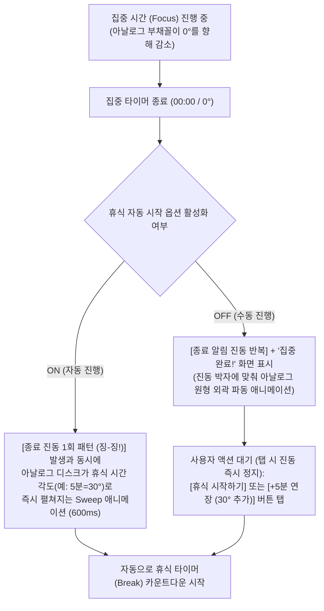
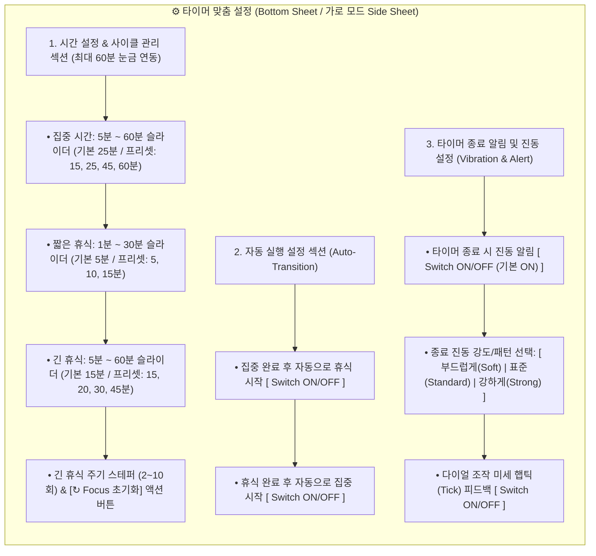

# Android 포모도로 타이머 앱 기획 및 디자인 가이드 (Design Handoff Guide v1.3)

> [!IMPORTANT]
> 본 문서는 안드로이드(Android) 기반 포모도로 타이머 앱 개발을 위해 **디자인 팀에 전달하는 UI/UX 기획 및 디자인 시스템 가이드라인**입니다.
> * **아날로그 타이머 최대 눈금:** **60분 고정 기준** (`360° = 60분`, `1분 = 6°`)
> * **타이머 배치 원칙:** 세로/가로 모드 모두 **큰 아날로그 타이머 바로 밑에 디지털 타이머를 수직 배치**하여 일관된 시각적 위계 유지
> * **지원 화면 방향:** **세로 모드(Portrait) 및 가로 모드(Landscape) 정식 지원** (스탠드 거치 및 태블릿/폴더블 대응)
> * **Focus 사이클 초기화:** 상단 세션 도트 옆 `[↻ Focus 초기화]` 칩 및 설정 시트 버튼을 통해 언제든 `Focus #1` 대기 상태로 즉시 리셋 지원
> * **백그라운드 상단 상태 표시줄 아이콘:** 앱이 백그라운드로 전환 시 스마트폰 상단 상태 표시줄(Status Bar)에 전용 포모도로 타이머 아이콘(`ic_stat_pomodoro`) 및 실시간 남은 시간 표시
> * **타이머 종료 진동 알림:** 세션 종료 시 **시각적 파동 모션과 동기화된 맞춤형 진동(Vibration) 피드백** 및 세부 설정 지원

---

## 🎨 UI/UX 디자인 시안 프리뷰 (Visual Mockups)

### 1) 세로 모드 (Portrait Mode) & 타이머 맞춤 설정 시안


### 2) 가로 모드 (Landscape Mode) 2단 분할 레이아웃 & 휴식/진동 파동 시안


---

## 1. 프로젝트 개요 및 핵심 디자인 컨셉

### 1.1 제품 비전 (Product Vision)
단순히 시간을 재는 도구를 넘어, **60분 기준의 직관적인 면적(아날로그)**과 **정밀한 숫자(디지털)**로 시간의 흐름을 동시에 체감하게 하며, 생동감 있는 시각적 모션과 **명확한 종료 진동 피드백**을 통해 몰입(Flow)과 휴식(Refresh)의 리듬을 만들어주는 **다이나믹 포모도로 타이머**입니다.

### 1.2 핵심 디자인 키워드 (Design Keywords)
* **True 60-Minute Analog (실제 60분 타임 타이머의 직관성):** 원 한 바퀴를 항상 60분으로 고정하여, 25분은 원의 약 42%(`150°`), 15분은 25%(`90°`)라는 절대적 시간 양감을 즉각 인지
* **Dynamic & Tactile Feedback (생동감 넘치는 시각·촉각 경험):** 세션 상태와 기기 방향에 따라 유기적으로 반응하는 모션 그래픽과, **타이머 종료 시 화면을 보지 않아도 상태를 알 수 있는 직관적인 진동 알림**
* **Consistent Vertical Timer Stack (일관된 타이머 수직 위계):** 화면 방향과 관계없이 **대형 아날로그 타이머(상단) + 디지털 타이머(하단)**가 하나의 코어 유닛으로 결합된 레이아웃

---

## 2. 핵심 기능 기획 및 UX 요구사항

### 2.1 타이머 시간 맞춤 설정 (60분 최대 눈금 기준)
아날로그 타이머의 최대 눈금이 **60분**으로 고정됨에 따라, 모든 타이머 세션은 최대 60분 이내에서 아날로그 다이얼 눈금과 **1:1로 정확히 매핑**되도록 설정 범위를 정의합니다.

| 설정 항목 | 기본값 (Default) | 설정 범위 (Range) | 아날로그 각도 변환 (`1분 = 6°`) | UI/UX 조작 방식 |
| :--- | :---: | :---: | :---: | :--- |
| **집중 시간 (Focus)** | **25분** | **5분 ~ 60분** | `30° ~ 360°` (기본 `150°`) | ① 메인 화면 아날로그 다이얼 직접 드래그 (`6°` 단위로 스냅)<br>② 설정 화면 내 슬라이더 또는 프리셋 칩 (15 / 25 / 45 / 60분) |
| **짧은 휴식 (Short Break)** | **5분** | **1분 ~ 30분** | `6° ~ 180°` (기본 `30°`) | 다이얼 드래그 또는 설정 내 슬라이더 / 프리셋 칩 (5 / 10 / 15분) |
| **긴 휴식 (Long Break)** | **15분** | **5분 ~ 60분** | `30° ~ 360°` (기본 `90°`) | 다이얼 드래그 또는 설정 내 슬라이더 / 프리셋 칩 (15 / 20 / 30분) |
| **긴 휴식 주기 (Intervals)** | **4세션** | **2 ~ 10세션** | 상단 세션 도트 인디케이터 표시 | 스테퍼(`-` / `+`) 버튼 컨트롤 |
| **Focus 사이클 초기화** | **`Focus #1` / 완료 `0회`** | - | 설정된 집중 시간 각도(기본 `150°`)로 복귀 | ① 상단 세션 도트 옆 `[↻ Focus 초기화]` 칩 탭<br>② 설정 시트 내 `[Focus 초기화]` 버튼 탭 |

> [!TIP]
> **60분 고정 다이얼 직접 조작 (Direct Dial Manipulation):**
> 대기(Ready) 상태에서 사용자가 아날로그 타이머의 부채꼴 끝단 핸들(Handle)을 잡고 원형 궤적을 따라 드래그하면, **6°(1분) 단위로 자석처럼 스냅(Snap)**되며 시간이 조절됩니다. 동시에 아날로그 타이머 바로 아래의 **디지털 타이머 숫자도 실시간으로 롤링**되어 직관성과 정밀함을 동시에 제공합니다.

### 2.2 세션 자동 전환 설정 (Auto-Transition Flow)
집중 시간이 종료되었을 때 사용자의 워크플로우 스타일에 따라 자동 또는 수동으로 휴식에 진입할 수 있도록 제어권을 제공합니다.



* **설정 옵션 구성:**
  1. **집중 완료 후 휴식 자동 시작 (Auto-start Breaks):** `Switch Toggle (ON/OFF)` — *필수 요구사항*
  2. **휴식 완료 후 집중 자동 시작 (Auto-start Focus):** `Switch Toggle (ON/OFF)` — *연속 포모도로 루프 구성용*
* **메인 화면 퀵 토글 배지:** 메인 화면의 세션 타이틀 부근에 `🔄 자동 휴식 ON/OFF` 캡슐형 배지를 배치하여, 설정 창을 열지 않고도 원탭으로 전환 모드를 바꿀 수 있도록 설계합니다.

### 2.3 타이머 종료 시 진동 알림 기능 (Timer Completion Vibration)
도서관, 독서실, 오피스 등 **소리를 낼 수 없는 환경**에서도 타이머 종료와 세션 전환을 확실하게 인지할 수 있도록 체계적인 진동 피드백을 설계합니다.

#### ① 세션 종류 및 자동 전환 여부에 따른 진동 패턴 차별화
사용자가 스마트폰 화면을 보지 않고 진동만으로도 **"집중이 끝났는지, 휴식이 끝났는지"** 구별할 수 있도록 파형(Waveform)을 다르게 디자인합니다.

| 상황 구분 | 진동 리듬 컨셉 | 상세 파형 규격 (`VibrationEffect.createWaveform`) | 시각적 동기화 모션 (Visual-Haptic Sync) |
| :--- | :--- | :--- | :--- |
| **집중 종료 → 휴식 진입 시** | **릴랙스 더블 펄스**<br>(길고 부드러운 2회 진동: *징~ 징~*) | `[대기 0ms, 진동 400ms, 휴지 200ms, 진동 600ms]`<br>진폭(Amplitude): `180 → 255` 부드러운 페이드인 | 진동이 울리는 순간 아날로그 타이머 중앙에서 바깥쪽으로 **2겹의 붉은/초록 동심원 파동(Ripple)**이 화면 끝까지 퍼져나감 |
| **휴식 종료 → 집중 진입 시** | **에너제틱 트리플 비트**<br>(짧고 경쾌한 3회 진동: *톡-톡-징!*) | `[대기 0ms, 진동 150ms, 휴지 100ms, 진동 150ms, 휴지 100ms, 진동 400ms]`<br>진폭(Amplitude): `255` (강하고 선명함) | 3번의 비트에 맞춰 하단 **디지털 타이머(`00:00`)와 아날로그 외곽 링이 3회 바운스(Bounce)**하며 집중 준비 환기 |
| **자동 전환 `ON` 상태** | **1회 알림 후 즉시 전환** | 위 패턴을 **1사이클(약 1.2초)**만 실행하고 즉시 다음 세션 시작 | 진동 종료와 동시에 다음 세션 부채꼴이 Sweep-in으로 채워짐 |
| **자동 전환 `OFF` 상태** | **연속 알림 (최대 5회 반복)** | 사용자가 `[휴식 시작하기]` 버튼을 누르거나 화면을 터치할 때까지 **2초 간격으로 최대 5회 반복 진동** | 화면 상단에 `📳 터치하여 진동 끄기` 힌트 표시 및 아날로그 타이머가 진동 주기에 맞춰 흔들리는(Shake/Pulse) 모션 |

#### ② 백그라운드 전환 시 상단 상태 표시줄 아이콘 및 화면 꺼짐(Lock Screen) 대응
* 앱이 백그라운드로 전환되면 스마트폰 최상단 상태 표시줄(Status Bar)에 **전용 포모도로 타이머 단색 아이콘(`ic_stat_pomodoro`, 24dp 투명 배경 화이트 실루엣)**이 표시되며, 알림 트레이에서 현재 세션과 남은 시간(`MM:SS`)을 실시간으로 확인하고 원탭으로 복귀할 수 있습니다.
* 타이머가 백그라운드에서 실행 중이거나 화면이 꺼진 상태에서 `00:00`에 도달하더라도, Android **Foreground Service (`PomodoroTimerService`)** 및 **Notification Channel**을 통해 설정된 종료 진동이 누락 없이 즉시 작동합니다.

---

## 3. 아날로그 & 디지털 타이머 컴포넌트 상세 규격

### 3.1 대형 아날로그 타이머 (60분 고정 다이얼 규격)
* **다이얼 눈금 체계 (60-Minute Scale):**
  * **외곽 눈금 (Tick Marks):** 총 60개 눈금 (`6°` 간격).
    * **5분 단위 주 눈금 (Major Ticks, 12개):** 길이 `10dp`, 두께 `2.5dp`, 불투명도 `80%`, 외곽에 `60(0), 5, 10, 15, 20, 25, 30, 35, 40, 45, 50, 55` 숫자 라벨(`12sp`, Medium) 표시.
    * **1분 단위 보조 눈금 (Minor Ticks, 48개):** 길이 `5dp`, 두께 `1dp`, 불투명도 `30%`.
  * **남은 시간 부채꼴 (Remaining Time Sector):**
    * `12시 방향(0°)`을 기준점으로 남은 시간만큼 색상이 채워진 디스크 형태.
    * 초 단위로 끊기지 않고 **60fps 연속 각도 계산(`남은 초 / 3600 * 360°`)**으로 부드럽게 줄어드는 스무스 모션 적용.
  * **종료 진동 파동 레이어 (Vibration Ripple Layer):**
    * 아날로그 타이머 배면에 동심원 형태의 파동 그래픽 레이어를 배치하여, 타이머 종료 진동이 울릴 때 진동 강도와 동일한 주기로 파동이 확산되도록 설계합니다.

### 3.2 하단 디지털 타이머 (Secondary Digital Readout)
* **배치 원칙:** 세로 모드와 가로 모드 **모두 대형 아날로그 타이머 바로 아래(`16dp ~ 28dp` 간격)에 수직 중앙 정렬**로 배치합니다 (`[Analog Timer]` → `[Digital Timer]` 단일 시각 그룹화).
* **타이포그래피 규격:**
  * 서체: 숫자 변경 시 좌우 너비 흔들림이 전혀 없는 **Monospace / Tabular Numbers (`tnum`)** 필수 적용.
  * 포맷: `MM : SS` (예: `25 : 00`, 60분 설정 시 `60 : 00`).
  * 크기: 세로 모드 `52sp`, 가로 모드 `44sp` (Bold, 자간 `-0.02em`).

---

## 4. 반응형 화면 레이아웃: 세로 모드 & 가로 모드

> [!IMPORTANT]
> 책상 위 스탠드나 독(Dock)에 스마트폰/태블릿을 가로로 거치해 두고 타이머를 사용하는 시나리오를 위해 **세로 모드(Portrait)와 가로 모드(Landscape) 모두 핵심 레이아웃 규격으로 정의**합니다. 두 모드 모두 **"큰 아날로그 타이머 밑에 디지털 타이머 배치"** 원칙을 동일하게 유지합니다.

### 4.1 세로 모드 (Portrait Layout - `360 × 800 dp` 기준)
단일 컬럼 수직 중심축 레이아웃으로, 한 손 조작과 직관적인 시선 흐름에 최적화합니다.

```
+---------------------------------------------------+
|  09:41  [⏱]                           📶  🔋 100% |  <- 0. 스마트폰 상단 상태 표시줄 (백그라운드 전환 시 [⏱] 포모도로 아이콘 표시)
+---------------------------------------------------+
|  🍅 FOCUS #2/4 ●●○○ [↻ Focus 초기화]   [📳] [⚙]   |  <- 1. Top Header (세션 타이틀, 사이클 도트, Focus 초기화 칩, 진동/설정)
|  (🔄 Auto-Break ON)        [집중 | 짧은휴식 | 긴휴식] |  <- 2. Sub Header (자동 휴식 퀵 배지 & 세션 전환 탭)
|                                                   |
|                     60                            |
|               55  . ~ ~ .   5                     |
|            50  . '   \   | ' . 10                 |
|              /        \  |     \                  |
|          45 |          \ | 25분 | 15              |  <- 3. 대형 아날로그 타이머
|             |           o-------'                 |     (60분 고정 눈금,
|          40  \                 /  20              |      280dp x 280dp)
|               .               .                   |
|            35   ' . _ _ _ . '  25                 |
|                     30                            |
|                     || (16dp 간격)                |
|                  2 4 : 5 9                        |  <- 4. 하단 디지털 타이머 (아날로그 바로 밑 배치, 54sp)
|               Focusing deeply...                  |
|               [ -5m ]    [ +5m ]                  |  <- 5. 빠른 시간 증감 칩
|                                                   |
|            ( ↺ )    [  ⏸  ]    ( ⏭ )             |  <- 6. 하단 다이나믹 모핑 아이콘 컨트롤 바
+---------------------------------------------------+
```

### 4.2 가로 모드 (Landscape Layout - `800 × 360 dp` 기준)
화면을 **좌측 55% (타이머 코어 영역)**와 **우측 45% (세션 정보 및 컨트롤 데스크 영역)**의 **2단 분할(Two-Pane) 구조**로 배치합니다.
* **좌측 영역 (Timer Unit):** **큰 아날로그 타이머 + 그 바로 밑에 디지털 타이머**를 세로로 묶어 배치함으로써, 세로 모드와 동일한 시각적 위계를 유지합니다.
* **우측 영역 (Control & Status Panel):** 현재 세션 진행도(포모도로 세션을 나타내는 4개의 도트 및 Focus 사이클 초기화 칩), 자동 휴식 전환 스위치, 종료 진동 알림 배지, 빠른 시간 조절(`-5분` / `+5분`), 대형 컨트롤 버튼을 배치합니다.

```
+-------------------------------------------------------------------------------+
|  09:41  [⏱]                                                       📶  🔋 100% |
+-------------------------------------------------------------------------------+
|               좌측 영역 (55%: 타이머 코어)      |    우측 영역 (45%: 상태 & 컨트롤)   |
|                                              |                                |
|                     60                       |  FOCUS #2/4  [집중|짧은휴식|긴휴식] ⚙ |
|               55  . ~ ~ .   5                |  ● ● ○ ○  [↻ Focus 초기화]      |
|            50  . '   \   | ' . 10            |                                |
|          45   |       \  |    |   15         |  +--------------------------+  |
|               |        o------'              |  | 자동 휴식 (Auto-Break) ON |  |
|          40    \             /    20         |  | 종료 진동 (표준)       ON |  |
|            35   ' . _ _ . '   25             |  +--------------------------+  |
|                     30                       |                                |
|                     || (8dp 간격)            |     Quick: [ -5m ]  [ +5m ]    |
|                  2 4 : 5 9                   |                                |
|              Focusing deeply...              |      ( ↺ )  [  ⏸  ]  ( ⏭ )    |
+-------------------------------------------------------------------------------+
```

### 4.3 세로 ↔ 가로 화면 회전 시 영역별 규격 비교

| 구성 요소 | 세로 모드 (Portrait) | 가로 모드 (Landscape) | 회전 전환 모션 (Orientation Transition) |
| :--- | :--- | :--- | :--- |
| **아날로그 타이머 크기** | `280dp × 280dp` (가로폭의 약 78%) | `220dp × 220dp` (세로 높이의 약 62%) | 크기와 위치가 끊기지 않고 부드럽게 보간(Shared Element) |
| **디지털 타이머 위치** | 아날로그 타이머 하단 `24dp` 아래 | 아날로그 타이머 하단 `16dp` 아래 | 아날로그 타이머와 한 덩어리로 묶여 좌측 패널로 함께 이동 |
| **디지털 타이머 폰트** | `52sp` Bold (`tabular-nums`) | `44sp` Bold (`tabular-nums`) | 스케일 트랜지션 적용 |
| **컨트롤 액션 버튼** | 화면 최하단 중앙 정렬 | 우측 패널 하단 배치 (버튼 너비 확장) | 하단에서 우측 패널로 슬라이드 & 페이드 인 (`400ms`) |
| **자동 전환 & 진동 상태** | 상단 바 `📳` 아이콘 및 캡슐 배지 | 우측 패널 상단 `📳` 퀵 토글 및 자동 휴식 카드 | 가로 거치 시 원터치로 진동/자동전환 제어 가능 |

---

## 5. 다이나믹 인터랙션 및 모션 가이드 (Dynamic UX)

> [!NOTE]
> 정적인 타이머 앱과 차별화하기 위해 **물리 기반 스프링 애니메이션(Spring Physics)**, **60분 다이얼 연동 모션**, **상태별 컬러 트랜지션**, **타이머 종료 진동과 결합된 시각 파동 효과**를 적용합니다.

### 5.1 상태별 다이나믹 테마 및 배경 효과 (State-Driven Ambience)

| 상태 (State) | 메인 포인트 컬러 (Accent) | 다이나믹 배경 / 모션 효과 |
| :--- | :--- | :--- |
| **집중 (Focus)** | **Energetic Coral Red**<br>`#FF5252` ~ `#FF7043` | • 몰입을 돕는 딥 다크(`#121318`) 배경 위에서 아날로그 타이머 외곽의 은은한 오로라 광원(Glow)이 **4초 주기로 천천히 호흡(Breathing)**<br>• 60분 눈금 중 현재 남은 시간 영역만 선명하게 빛나고, 지나간 시간 영역의 눈금은 암전 처리 |
| **짧은 휴식 (Short Break)** | **Refreshing Mint / Teal**<br>`#00E676` ~ `#26A69A` | • 집중 종료 진동과 함께 아날로그 원형에서 초록빛 물결 파동(Ripple)이 퍼져나가며 배경 톤이 청량한 틸(Teal) 그라데이션으로 **크로스페이드(800ms)**<br>• 부유하는 미세 파티클이 위로 천천히 상승하며 이완 유도 |
| **긴 휴식 (Long Break)** | **Calm Ocean Blue / Indigo**<br>`#448AFF` ~ `#7C4DFF` | • 깊고 편안한 네이비/인디고 그라데이션과 물결 형태의 웨이브 애니메이션 |
| **타이머 종료 (00:00 진동 중)** | **High-Contrast Pulse**<br>세션 컬러 `100%` 밝기 발광 | • **종료 진동 파형에 맞춰 아날로그 타이머 전체가 탄성 있게 떨리는(Haptic Shake & Ripple) 시각 효과**<br>• 하단 디지털 타이머 `00:00` 텍스트가 진동 리듬과 동기화되어 스케일 업/다운 |

### 5.2 핵심 마이크로 인터랙션 및 햅틱/진동 설계

1. **타이머 시작 (60분 다이얼 Sweep-In):**
   * 시작 버튼을 누르는 순간 버튼이 탄성 있게 눌렸다 펴지며(`Spring Damping: 0.6`), 아날로그 타이머의 `0분(12시)` 눈금부터 설정된 시간 눈금(예: `25분 = 150°`)까지 부채꼴 게이지가 **시계 방향으로 역동적으로 펼쳐지는(Sweep-in, 500ms) 연출**.
2. **다이얼 드래그 & 디지털 오도미터 연동:**
   * 사용자가 60분 아날로그 다이얼을 드래그하여 시간을 바꿀 때, 1분(`6°`) 눈금을 지날 때마다 미세한 시계 태엽 햅틱(`EFFECT_TICK`)이 울리고, 바로 아래의 **디지털 타이머 숫자가 아날로그 계기판(Odometer)처럼 위아래로 빠르게 롤링**됩니다.
3. **마감 임박 텐션 효과 (Final 10 Seconds Tension):**
   * 종료 10초 전(`00:10` ~ `00:01`)부터 아날로그 타이머의 마지막 `1°` 부채꼴 영역과 하단 디지털 타이머 숫자가 1초마다 심장 박동처럼 미세하게 팝업(`Scale 1.0 → 1.08 → 1.0`)됩니다.
4. **타이머 종료 진동 & 시각 파동 동기화 (Completion Vibration & Ripple Sync):**
   * 타이머가 `00:00`에 도달하는 즉시 **종료 진동(Completion Vibration)**이 작동하며, 아날로그 타이머 외곽 베젤에서 진동 박자와 정확히 일치하는 **Shockwave Ring(충격파 고리)**이 퍼져 나갑니다.
   * 만약 가로 모드로 책상 스탠드에 거치해 둔 상태라면, 진동 소리와 함께 화면 전체의 가장자리가 부드럽게 점멸(Edge Lighting)하여 시각적 인지도를 극대화합니다.

---

## 6. 설정 UI 상세 가이드 (시간 설정, 자동 전환 & 종료 진동)

메인 화면의 `[⚙ 설정]` 버튼 탭 시 호출되는 화면 구성안입니다. 상단 바의 `[📳]` 아이콘을 탭하면 설정 창을 열지 않고도 **종료 진동 ON/OFF**를 즉시 토글할 수 있으며, 세부 설정은 시트 내부에서 제공합니다.



* **진동 미리보기(Preview) 인터랙션:**
  * 설정 화면에서 사용자가 `종료 진동 강도/패턴` 칩(`부드럽게` / `표준` / `강하게`)을 탭하면, **해당 진동 파형이 즉시 샘플로 한 번 울리면서** 뒤에 보이는 아날로그 타이머에 파동 애니메이션이 시연되어 사용자가 직관적으로 진동 세기를 고를 수 있게 합니다.

---

## 7. 디자인 팀 전달용 산출물 체크리스트 (Handoff Checklist)

### 7.1 디자인 시스템 규격 (Material 3 기반)
* **다크 모드 퍼스트 (Dark Mode First):** 세로/가로 거치 시 OLED 번인 방지 및 몰입감 극대화를 위해 **딥 다크 테마(`#121318`)를 기본(Default)**으로 디자인하고 라이트 테마(`#F8F9FA`)를 병행 정의합니다.
* **반응형 브레이크포인트 (Responsive Breakpoints):**
  * **Compact Portrait (세로 스마트폰):** `Width < 600dp, Aspect Ratio < 1.0` → 1단 수직 스택 레이아웃
  * **Compact/Medium Landscape (가로 스마트폰 및 태블릿):** `Width >= 600dp OR Aspect Ratio > 1.2` → 좌측(아날로그+하단 디지털 타이머) + 우측(컨트롤 패널) 2단 분할 레이아웃

### 7.2 디자이너 필수 산출물 목록
1. **Figma 화면 설계서 (세로 모드 & 가로 모드 쌍으로 제작):**
   * 메인 타이머 화면 (대기 / 집중 진행 중 / 일시정지 / **타이머 종료 및 진동 알림 발생 상태** / 자동 전환 중 / 짧은 휴식 / 긴 휴식) — **Portrait & Landscape 각 7종**
   * 상단 세션 영역의 `[↻ Focus 초기화]` 칩 및 상단 바 진동 퀵 토글 아이콘(`📳 진동 켜짐` / `📴 진동 꺼짐`) 상태별 컴포넌트
   * 백그라운드 전환 시 스마트폰 상단 상태 표시줄(Status Bar) 단색 아이콘(`ic_stat_pomodoro.xml`, `24×24dp`, 투명 배경 + `#FFFFFF` 포모도로 다이얼 실루엣) 및 알림 트레이 카드 시안
   * 설정 화면: 시간 설정 + `Focus 사이클 초기화` + 자동 전환 + **종료 진동 ON/OFF 및 강도 선택 UI**가 포함된 Bottom Sheet(세로) & Side Sheet(가로)
2. **60분 아날로그 타이머 컴포넌트 규격서:**
   * 60분 눈금(5분 주 눈금 12개 + 1분 보조 눈금 48개) 벡터 가이드 및 숫자 라벨 배치 가이드
   * 부채꼴(Sector) 그라데이션, 끝단 발광 핸들(Glowing Handle), **종료 진동 시 확산되는 동심원 파동(Vibration Shockwave Ring) 그래픽 스타일** 정의
3. **모션 그래픽 & 햅틱 명세서:**
   * 상태 전환(Focus ↔ Break) 및 **타이머 종료 진동 동기화 파동 이펙트용 Lottie JSON / Rive** 파일
   * 안드로이드 개발팀 전달용 `VibrationEffect` 타이밍 배열(`timings[]`, `amplitudes[]`) 가이드 포함
