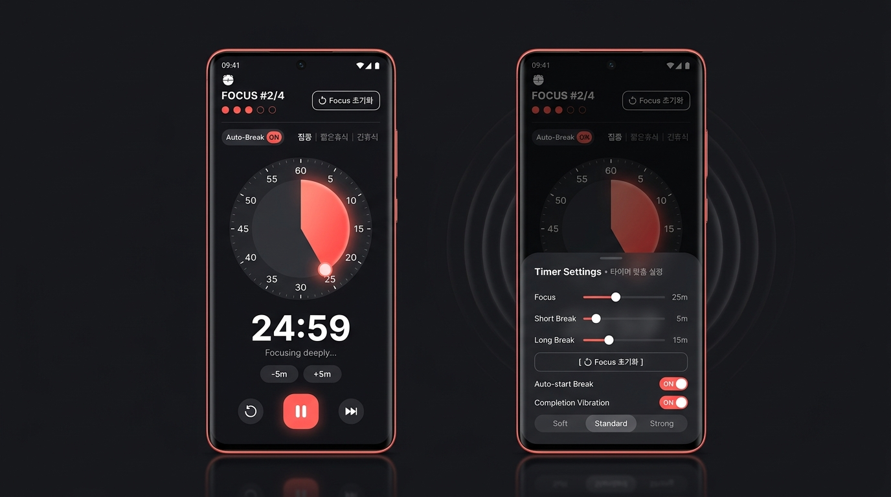
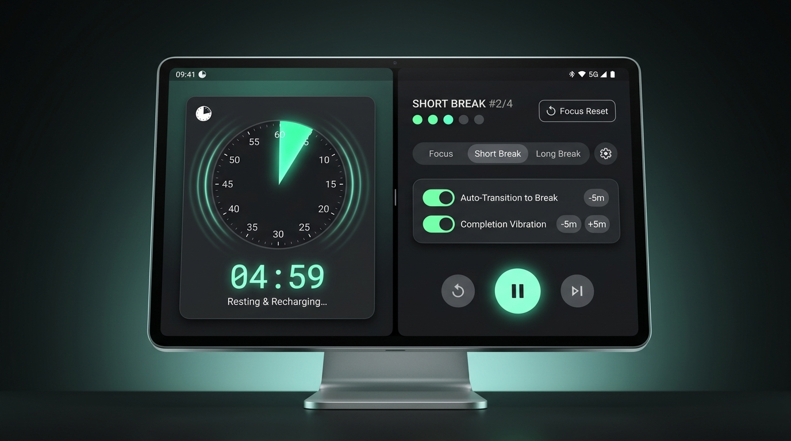
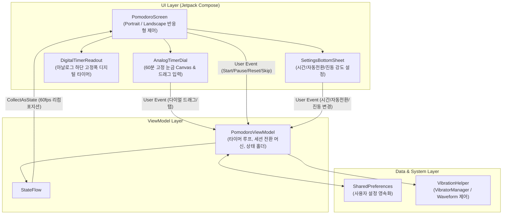

# 🍅 Dynamic Pomodoro Timer (Android) — 프로젝트 기술 스펙 문서

**Dynamic Pomodoro Timer**는 **60분 고정 눈금의 대형 아날로그 타이머**와 **그 바로 아래 배치된 고정폭(Monospace) 디지털 타이머**를 결합하여 직관적인 시간 양감과 정밀한 카운트다운을 동시에 제공하는 안드로이드 네이티브 애플리케이션입니다.

세션별 시간 맞춤 설정, 집중 완료 후 자동 휴식 전환, 타이머 종료 시 시각적 충격파(Shockwave Ripple)와 동기화되는 맞춤형 진동 알림, 그리고 세로 모드(Portrait)와 가로 모드(Landscape) 반응형 UI를 지원합니다.

---

## 📱 UI/UX 디자인 시안 프리뷰

| 세로 모드 (Portrait Mode) & 설정 바텀시트 | 가로 모드 (Landscape Mode) 2단 레이아웃 |
| :---: | :---: |
|  |  |

---

## 🛠 1. 기술 스택 및 빌드 환경 (Technical Stack)

| 구분 | 적용 기술 / 버전 | 비고 |
| :--- | :--- | :--- |
| **Language** | **Kotlin `1.9.22`** | Coroutines, StateFlow 기반 비동기/반응형 처리 |
| **UI Framework** | **Jetpack Compose (BOM `2024.02.01`)** | Material 3, Custom Canvas 그래픽, Spring/Infinite Animation |
| **Architecture** | **MVVM (Model-View-ViewModel) + UDF** | 단방향 데이터 플로우(Unidirectional Data Flow) |
| **Android SDK** | **Compile SDK `34` / Target SDK `34` / Min SDK `26`** | Android 8.0 (Oreo) ~ Android 14+ 완벽 호환 |
| **Build System** | **Gradle `8.5` + Android Gradle Plugin `8.2.2`** | Kotlin DSL (`.gradle.kts`), JDK `17` |
| **Local Storage** | **Android `SharedPreferences`** | 타이머 시간 설정, 자동 전환 여부, 진동 강도 영구 저장 |
| **Hardware API** | **`Vibrator` / `VibratorManager` (`VibrationEffect`)** | 타이머 종료 파형 진동(`createWaveform`) 및 다이얼 조작 햅틱 |
| **SDK 설치 경로** | `/home/andrew/workspaces/android-sdk` | `platforms;android-34`, `build-tools;34.0.0`, `platform-tools` |

---

## 🏗 2. 시스템 아키텍처 및 데이터 흐름 (Architecture)

본 프로젝트는 **단방향 데이터 흐름(UDF, Unidirectional Data Flow)** 패턴을 준수하여 상태 관리의 예측 가능성과 UI 렌더링 성능을 보장합니다.



---

## 📂 3. 프로젝트 디렉토리 및 패키지 구조

```text
/home/andrew/workspaces/pomodoro_app/
├── PLANNING.md                         # 서비스 기획서 (요구사항 및 사용자 플로우)
├── DESIGN_GUIDE.md                     # UI/UX 디자인 가이드 문서
├── README.md                           # 프로젝트 기술 스펙 문서 (현재 문서)
├── DynamicPomodoro.apk                 # 최종 빌드된 설치용 APK 파일
├── assets/                             # 세로/가로 모드 UI 디자인 시안 이미지
│   ├── pomodoro_portrait_mockup.jpg
│   └── pomodoro_landscape_mockup.jpg
├── build.gradle.kts                    # 루트 Gradle 설정
├── settings.gradle.kts                 # 프로젝트 모듈 설정
├── gradle.properties                   # JVM 및 AndroidX 속성 (JDK 17 지정)
├── local.properties                    # Android SDK 경로 설정 (/home/andrew/workspaces/android-sdk)
└── app/
    ├── build.gradle.kts                # 앱 모듈 의존성 및 빌드 설정
    └── src/
        ├── main/
        │   ├── AndroidManifest.xml     # VIBRATE 권한 및 화면 회전(configChanges) 설정
        │   ├── java/com/example/pomodoro/
        │   │   ├── MainActivity.kt                     # 엔트리 액티비티 및 Keep-Screen-On 제어
        │   │   ├── model/
        │   │   │   └── PomodoroModels.kt               # 데이터 모델 및 60분 고정 각도 계산 수식
        │   │   ├── util/
        │   │   │   └── VibrationHelper.kt              # 종료 진동 파형(Waveform) 및 다이얼 햅틱 제어
        │   │   ├── viewmodel/
        │   │   │   └── PomodoroViewModel.kt            # 정밀 카운트다운 엔진 및 자동/수동 전환 로직
        │   │   └── ui/
        │   │       ├── PomodoroScreen.kt               # 세로(1단) & 가로(2단) 반응형 메인 화면
        │   │       ├── components/
        │   │       │   ├── AnalogTimerDial.kt          # 60분 고정 눈금 아날로그 타이머 (Custom Canvas)
        │   │       │   ├── DigitalTimerReadout.kt      # 하단 오도미터 롤링 디지털 타이머
        │   │       │   └── SettingsSheet.kt            # 타이머 시간/자동전환/진동 설정 바텀시트
        │   │       └── theme/
        │   │           └── Theme.kt                    # 상태별 다이나믹 컬러 트랜지션 테마
        │   └── res/                                    # 문자열, 테마, 런처 벡터 리소스
        └── test/java/com/example/pomodoro/
            └── PomodoroModelTest.kt                    # 60분 눈금 각도 변환 및 스냅 유닛 테스트
```

---

## ⚙️ 4. 핵심 기능별 기술 구현 명세 (Core Technical Specifications)

### 4.1 60분 고정 눈금 대형 아날로그 타이머 (`AnalogTimerDial.kt`)
* **60분 고정 각도 변환 수식 (`360° = 60분`, `1분 = 6°`):**
  * 설정된 타이머 시간에 상관없이 원 한 바퀴는 항상 **60분(`3,600,000 ms`)**을 나타냅니다.
  * 남은 시간(`remainingMillis`)에 대한 부채꼴 중심각($\theta$)은 다음과 같이 계산됩니다:
    $$\theta = \text{clamp}\left(\frac{\text{remainingMillis}}{3,600,000} \times 360^\circ,\ 0^\circ,\ 360^\circ\right)$$
    *(예: 25분 = $150^\circ$, 15분 = $90^\circ$, 5분 = $30^\circ$)*
* **다이얼 드래그 직접 시간 설정 (Direct Manipulation):**
  * `READY` 또는 `PAUSED` 상태에서 사용자가 다이얼을 터치/드래그하면 `atan2(dy, dx)`를 통해 12시 방향(`-90°`) 기준 시계 방향 각도를 구하고, 이를 `6°` 단위로 반올림하여 `1분` 단위로 스냅(Snap)합니다.
  * 분 단위가 변경될 때마다 `VibrationHelper.vibrateDialTick()`을 호출하여 물리적인 다이얼을 돌리는 듯한 촉각 피드백을 제공합니다.

### 4.2 아날로그 하단 디지털 타이머 (`DigitalTimerReadout.kt`)
* **수직 위계 고정 (Vertical Stack):**
  * 세로 모드(`PortraitSingleColumnLayout`)와 가로 모드(`LandscapeTwoPaneLayout`의 좌측 타이머 코어 패널) 모두 **대형 아날로그 타이머 바로 아래에 디지털 타이머를 배치**합니다.
* **오도미터 롤링 & 고정폭 숫자 (`FontFamily.Monospace`):**
  * 각 자리 숫자(`M`, `M`, `S`, `S`)를 개별 `AnimatedContent`로 분리하여 숫자가 바뀔 때 위아래로 미끄러지듯 회전하는 슬라이드 트랜지션을 구현했습니다.
  * 종료 10초 전(`00:10` ~ `00:01`)에는 `spring(DampingRatioMediumBouncy)` 기반의 심장박동 스케일 애니메이션이 작동합니다.

### 4.3 드리프트 없는 정밀 카운트다운 및 자동 휴식 전환 (`PomodoroViewModel.kt`)
* **드리프트 방지 타이머 루프:**
  * 단순 `delay(1000L)` 누적 오차를 방지하기 위해 타이머 시작 시점의 `SystemClock.elapsedRealtime() + remainingMillis`를 목표 시각(`targetEndRealtime`)으로 고정하고, `40ms`(약 25fps) 주기로 남은 시간을 재계산하여 아날로그 부채꼴이 끊김 없이 부드럽게 줄어들도록 구현했습니다.
* **집중 완료 후 자동 휴식 전환 (`autoStartBreak`):**
  * `autoStartBreak == true`: 집중 타이머가 `00:00`에 도달하면 종료 진동 1사이클과 동심원 충격파 애니메이션을 `1.3초`간 재생한 뒤, 자동으로 짧은 휴식(또는 지정된 세션 주기 도달 시 긴 휴식)으로 전환하여 즉시 카운트다운을 시작합니다.
  * `autoStartBreak == false`: `TimerRunState.COMPLETED_WAITING` 상태로 전환되며, 사용자가 `[휴식 시작]` 버튼을 누르거나 화면을 터치할 때까지(최대 5회) 주기적으로 종료 진동과 파동 효과를 반복합니다.
* **포모도로 집중(Focus) 사이클 초기화 (`resetFocusCycle` / `resetToFirstFocusCycle`):**
  * 상단 세션 표시 영역(`FOCUS #1/4` 및 사이클 도트 옆)의 `[Focus 초기화]` 칩 버튼 또는 설정 바텀시트 내 `[Focus 초기화]` 버튼을 탭하면, 진행 중인 타이머/진동을 즉시 중단하고 `SessionType.FOCUS`, `currentCycleIndex = 1`, `completedFocusSessions = 0`, `TimerRunState.READY` 상태로 초기화합니다.

### 4.4 타이머 종료 진동 알림 엔진 (`VibrationHelper.kt`)
* Android API 버전에 맞춰 `VibratorManager` (API 31+) 및 `Vibrator`를 분기 처리하고, `VibrationEffect.createWaveform(timings, amplitudes, -1)`을 사용해 세션별 맞춤형 진동 파형을 생성합니다:
  * **집중 종료 시 (릴랙스 더블 펄스):** `timings = [0, 400, 200, 600] ms` (길고 부드러운 2회 진동)
  * **휴식 종료 시 (에너제틱 트리플 비트):** `timings = [0, 150, 100, 150, 100, 400] ms` (짧고 경쾌한 3회 진동)
* **진동 강도 3단계 설정 및 실시간 프리뷰:**
  * `Soft (진폭 110)` / `Standard (진폭 190)` / `Strong (진폭 255)` 선택 시 즉시 해당 진동 파형과 아날로그 다이얼 충격파 모션을 시연합니다.

### 4.5 백그라운드 전환 시 상단 상태 표시줄 아이콘 (`PomodoroTimerService.kt` & `ic_stat_pomodoro.xml`)
* **상단 상태 표시줄(Status Bar) 아이콘 표시:**
  * `MainActivity.onStop()` (화면 회전 제외) 시점에 `PomodoroViewModel.onAppBackgroundStateChanged(true)`가 호출되어 `PomodoroTimerService` 포그라운드 서비스 및 상단 알림을 시작합니다.
  * 안드로이드 상태 표시줄 규격(24dp 단색 화이트 실루엣 + 투명 배경)에 맞춘 `@drawable/ic_stat_pomodoro` 아이콘이 스마트폰 상단 바에 표시되며, 실시간 남은 시간(`MM:SS`)과 세션 상태를 보여줍니다.
  * 알림 탭 시 `SingleTop` 인텐트로 즉시 앱으로 복귀하며, `MainActivity.onStart()` 복귀 시 상단 아이콘이 자동으로 해제됩니다.

---

## 🚀 5. 빌드 및 APK 생성/설치 가이드

### 5.1 환경 변수 및 사전 요구사항
* **JDK:** OpenJDK 17 (`/usr/lib/jvm/java-17-openjdk-amd64`)
* **Android SDK:** `/home/andrew/workspaces/android-sdk`

### 5.2 커맨드라인 빌드 명령어
```bash
export JAVA_HOME=/usr/lib/jvm/java-17-openjdk-amd64
export ANDROID_SDK_ROOT=/home/andrew/workspaces/android-sdk
cd /home/andrew/workspaces/pomodoro_app

# 유닛 테스트 실행
./gradlew testDebugUnitTest

# 디버그 및 릴리즈 APK 빌드
./gradlew assembleDebug assembleRelease
```

### 5.3 생성된 최종 APK 파일 위치
* **프로젝트 루트 최종 APK:** `/home/andrew/workspaces/pomodoro_app/DynamicPomodoro.apk`
* **Release APK:** `/home/andrew/workspaces/pomodoro_app/app/build/outputs/apk/release/app-release.apk`
* **Debug APK:** `/home/andrew/workspaces/pomodoro_app/app/build/outputs/apk/debug/app-debug.apk`

### 5.4 ADB를 통한 기기 설치 방법
```bash
/home/andrew/workspaces/android-sdk/platform-tools/adb install -r /home/andrew/workspaces/pomodoro_app/DynamicPomodoro.apk
```
